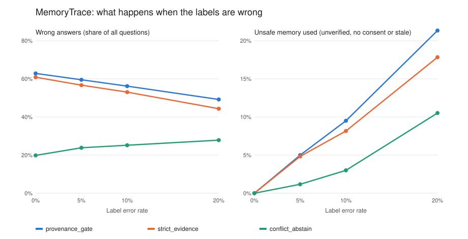

# MemoryTrace: which memory should an AI assistant trust?

**Area:** agentic AI, agent memory, evidence and consent
**Version:** 1.1.0 (29 October 2026)
**Runs on:** Python 3.9+, standard library only. Part 3 needs Ollama with `qwen2.5:3b` and `llama3.1:8b`.

## Research questions
1. Retrieval gates (verified source, consent, not expired) remove unsafe memories when their labels are perfect. How much unsafe memory gets through when the labels are sometimes wrong, and how many wrong answers remain?
2. When a real local LLM reads six memories about the same project, which one does it rely on, and does a short rule in the prompt make it skip stale, unverified or non-consented memories, in English and Roman Urdu?

## What is in the repository
| Part | File | What it measures |
|---|---|---|
| 1. Base policies | `benchmark.py` | Four retrieval policies on 600 synthetic questions, 6 candidate memories each (3,600 rows). |
| 2. Conflicts and noisy labels | `noise.py` | The two gates, plus `conflict_abstain` (answer only if the remaining memories agree), with each label flipped at 0%, 5%, 10% and 20%. Scored on the true labels. |
| 3. Real agents | `llm_probe/` | 20 of the scenarios as text prompts. The model names the memory it used, or says unknown or CONFLICT. Two prompts (`plain`, `rule`), English and Roman Urdu questions. |

Part 1 is a sanity check: the gates filter on exactly the labels used to score them, so with perfect labels their unsafe-memory rates are 0% by construction.

**A design finding from part 2:** in the base data the correct memory is never the only one that passes the gate. In about 80% of questions a verified, consented, current memory with a different answer passes too, and in the rest the correct memory is unverified and only the wrong one passes. So the base accuracy (about 37%) comes from a tie-break on the quality score, not from the gate. `conflict_abstain` makes this visible.

## Run
```bash
python3 run_benchmark.py                 # parts 1 and 2 (seconds)
python3 -m unittest discover -s tests -v # offline tests, no model needed
python3 llm_probe/probe.py               # part 3: 160 prompts with two local models (Ollama running)
```

## Results
_To be filled from my run._

### Part 2: conflicts and noisy labels
| Label error | Policy | Coverage | Wrong answers | Unsafe memory used |
|---|---|---|---|---|
| | | | | |



### Part 3: which memory the models used
| Model | Language | Prompt | Current verified | Verified conflict | Stale | Unverified | No consent | Other project | CONFLICT | Unknown |
|---|---|---|---|---|---|---|---|---|---|---|
| | | | | | | | | | | |

## My notes
_To be added after reading the answers._

## Limitations
- Parts 1 and 2 are a simulator with hand-set distributions; labels are flipped independently, while real label errors are often correlated.
- Answers are four status words, so a wrong memory can still give the right word by chance; part 3 scores the memory the model names, not only the word.
- Part 3 uses 20 scenarios, two small local models, one run at temperature 0, and memories written as structured lines rather than natural notes.
- No real people, projects or records are involved.

## Related work
- Lewis, P. et al. (2020). Retrieval-augmented generation for knowledge-intensive NLP tasks. *NeurIPS 2020*.
- Packer, C. et al. (2023). MemGPT: towards LLMs as operating systems. arXiv:2310.08560.
- See also [`memtrust-agent-memory-benchmark/`](https://github.com/MHKhan50/agentic-ai-research-log/tree/main/memtrust-agent-memory-benchmark) in my research log (planted memories and a trust filter).

## Licence
Code: MIT (`LICENSE`). Generated data: CC BY 4.0 (`dataset_card.md`).
